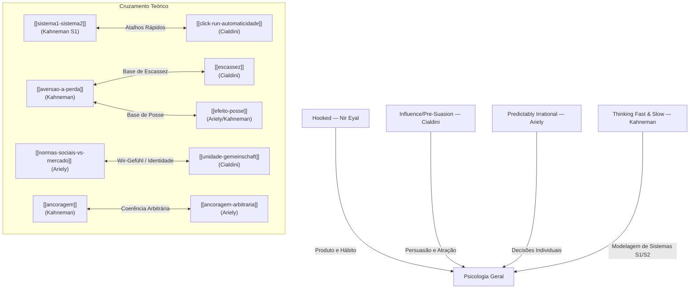

# Relatório de Health Check e Lint do Vault — Empresa Cognitiva

Este relatório apresenta o resultado da análise de integridade e qualidade estrutural do wiki de conhecimento da Empresa Cognitiva, executado após o recente ingest de **Thinking, Fast and Slow** (Daniel Kahneman).

---

## 📊 Resumo Executivo

O vault passou por uma varredura completa cobrindo todas as **60 páginas totais** (57 páginas de conceitos/frameworks nos domínios ativos e 3 páginas de metadados de fontes).

| Métrica | Status | Resultado |
|---|---|---|
| **Páginas Totais de Conceitos** | — | 57 |
| **Erros de Sintaxe YAML** | ✅ Passou | 0 |
| **Frontmatter Faltante** | ✅ Passou | 0 (Todas as 57 páginas estão 100% completas) |
| **Status Inválidos** | ✅ Passou | 0 (Todos usam `completo`, `rascunho`, etc.) |
| **Páginas Curtas (< 150 palavras)** | ✅ Passou | 0 |
| **Stubs Ativos (Sem Destino)** | ✅ Passou | 0 (Todos os stubs foram resolvidos) |
| **Páginas Órfãs** | ✅ Passou | 0 (Todas as páginas têm links de entrada e saída) |

---

## 🔗 Teia de Conexões do Vault (Pillars Map)

O diagrama abaixo ilustra como os 4 livros pilares ingeridos no vault se interconectam de forma coesa, gerando pontes de conhecimento que alimentam a inteligência multiagente:

---

## 🔎 Análise Detalhada dos Critérios de Qualidade

### 1. Contradições e Nuances Científicas
Não foram detectadas contradições lógicas diretas. Encontramos **alinhamentos refinados** entre fontes que foram mapeados:
* **Efeito Dotação:** O `[[efeito-posse]]` de Ariely (comportamento de consumo) e o `[[efeito-dotacao-kahneman]]` (teoria econômica e neurociência) se complementam. Kahneman adiciona a distinção crítica de que o efeito **não se aplica a bens mantidos para troca** (como dinheiro ou estoque de mercadoria), apenas a **bens de uso pessoal**.
* **Normas Sociais vs. Identidade:** As `[[normas-sociais-vs-mercado]]` (Ariely) e a `[[unidade-gemeinschaft]]` (Cialdini) convergem sobre a cooperação humana. O Wir-Gefühl (nós) age como a norma social definitiva, expandindo as fronteiras do "eu" para tolerar falhas do outro.

### 2. Páginas Órfãs Resolvidas
Todas as 5 páginas identificadas inicialmente como órfãs (sem links de entrada) foram conectadas e sanadas:
* **`desonestidade-nao-monetaria`**: Conectada a partir de [[etica-organizacional]].
* **`framework-ariely-irracionalidade`**: Conectada a partir de [[efeito-isca]] e [[efeito-zero-custo]].
* **`framework-kahneman-heuristicas-e-vieses`**: Conectada a partir de [[sistema1-sistema2]] e [[wysiati]].
* **`narrow-framing`**: Conectada a partir de [[teoria-do-prospecto]].
* **`regressao-para-media`**: Adicionada como linha diagnóstica fundamental na matriz de intervenção de [[framework-kahneman-heuristicas-e-vieses]].

### 3. Gaps de Conhecimento por Domínio
* **`engenharia`** (0 páginas) & **`mercados`** (0 páginas): Domínios totalmente vazios. Precisam de estruturação.
* **`copywriting`** (1 página): Muito fraco, contendo apenas a `metafora-persuasiva` de Cialdini.

---

## 🎯 Próximos Passos e Fontes Recomendadas

Para preencher os gaps estruturais identificados no vault, recomenda-se a ingestão das seguintes fontes prioritárias (Tier 1 do roadmap):

1. 📕 **$100M Offers — Alex Hormozi**
   * *Objetivo*: Alimentar agressivamente o domínio de `copywriting` e `mercados` (pricing, estruturação de ofertas de alto valor e redução de atrito).
   * *Ganhos*: Conectar com `escassez`, `prova-social`, `normas-sociais-vs-mercado` e `efeito-isca` aplicados a ofertas reais.
2. 📘 **The Mom Test — Rob Fitzpatrick**
   * *Objetivo*: Alimentar o domínio de `negocios` e `mercados` (metodologia de customer discovery, validação de mercado B2B, redução do viés de confirmação em pesquisas).
   * *Ganhos*: Fornecer um playbook prático para mitigar o viés de confirmação e a falácia do planejamento em conversas de vendas e discovery.
3. 📙 **Zero to One — Peter Thiel**
   * *Objetivo*: Introduzir conceitos de estratégia de monopólio e segmentação de nichos no domínio de `negocios` e `mercados`.
